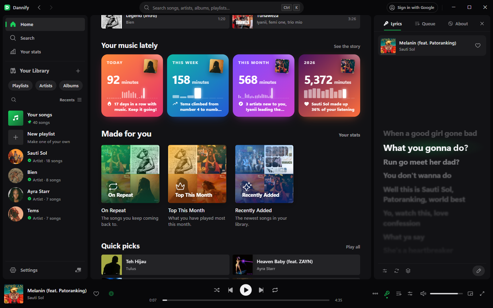
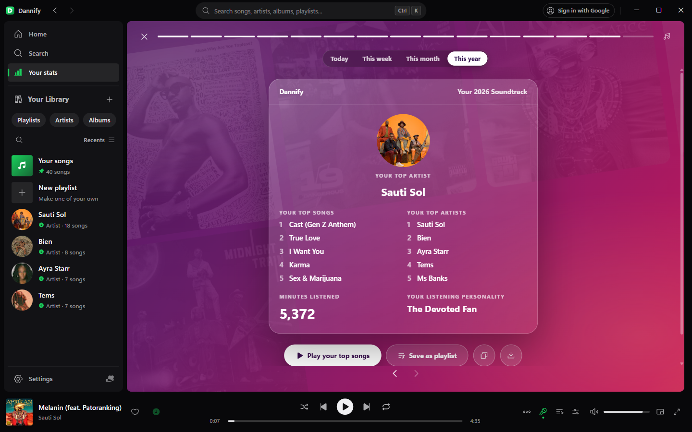
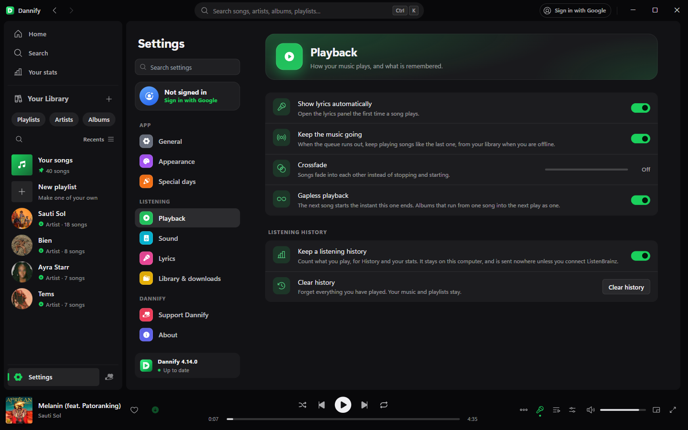
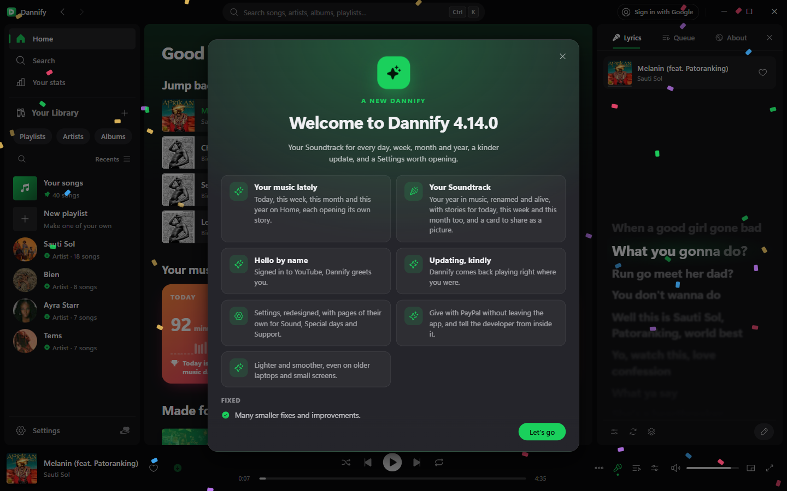
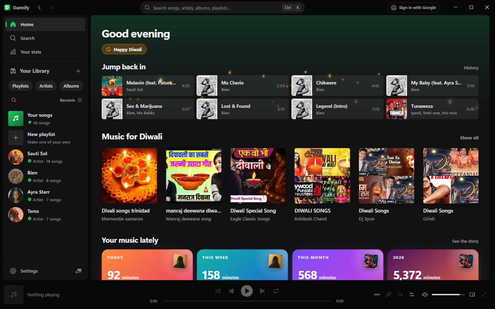
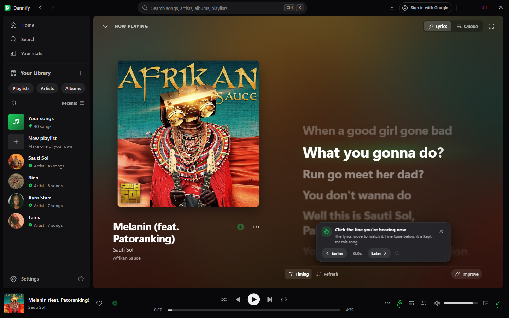

# Dannify

[](https://github.com/Riskraptor/Dannify/releases/latest)
[](#download)
[](LICENSE)

A music player for Windows, Linux, macOS and Android. Search for anything,
play it straight away, and save the songs you want to keep in your library,
with artwork, tags and synced lyrics, to play offline.

I built it because every other option was either a browser tab pretending to
be an app, or a downloader with no player attached. This is one program: a
native window, a tray icon and media keys. On a phone it is the same program,
running on the phone itself, with the lock screen, the notification and your
headphones' buttons playing along.


## What it does

- **Play anything, at once.** Search the YouTube Music catalogue and play
  anything in about a third of a second. Search opens on the charts and top
  artists where you are, what is newly out, and moods and genres.
- **Paste a link.** A Spotify song, album, playlist or artist opens on a page
  of its own, ready to play, save, or keep as a playlist of yours in one
  click. YouTube and YouTube Music links open too, and a Spotify podcast
  opens the same show on YouTube Music.
- **Keep what you love.** Saved songs live in your library with their
  artwork, tags and lyrics, and play without a connection.
- **Lyrics that follow the song**, lighting up word by word. Click the line
  you hear if they run early or late. If a song has none, write them and tap
  the timing in, and everyone who plays that song gets them.
- **Listen together.** Start a room, share its six-letter code, and everyone
  in it hears the same song at the same moment on their own device. Guests
  suggest songs and send reactions. Free, no account needed.
- **Your listening, told back to you.** History, Your stats, mixes that keep
  themselves up to date (Right About Now, On Repeat, Forgotten Favourites
  and more), and Your Soundtrack: your year in music as a story you can play.
- **Sign in with Google** for your own home feed, liked songs and playlists.
- **Special days**, wherever you are: the New Year, Ramadan and Eid, Diwali,
  Christmas and many more on your country's own dates, each with its own
  look, music and page.
- **Six languages**: English, Français, Español, Português, Deutsch and
  Kiswahili.
- **At ease offline**, and it picks up where you left off, down to the second.
- **On Android**: a home-screen widget, the lock screen and notification,
  tablets, and Android TV, Google TV and Fire TV with the remote.

What changed in each version is in [CHANGELOG.md](CHANGELOG.md).

| | |
| --- | --- |
|  |  |
|  |  |
|  |  |
|  |  |
|  |  |
|  |  |
|  |  |
|  |  |

## Download

Get the newest version from
[riskraptor.github.io/Dannify](https://riskraptor.github.io/Dannify/) or
straight from the
[latest release](https://github.com/Riskraptor/Dannify/releases/latest).
Pick the one file for your device:

| Your device | The file |
| --- | --- |
| Windows 10 and 11 | `Dannify-Setup-<version>.exe` |
| Mac with Apple silicon (M1 and later) | `macos-Dannify-<version>-arm64.dmg` |
| Mac with an Intel processor | `macos-Dannify-<version>-x64.dmg` |
| Ubuntu, Debian, Mint and the like | `linux-dannify_<version>_amd64.deb` |
| Android phones, tablets and TVs (Android 7.0 and later) | `android-Dannify-<version>-arm64.apk` |
| Chromebooks and Android emulators | `android-Dannify-<version>-x86_64.apk` |

The other files in a release (`.dsig`, `.zip`, `package-…` and
`latest.json`) are what Dannify updates itself from; you do not need them.

**Windows:** run the setup and follow it.

**macOS** (11 Big Sur and later): open the `.dmg`, drag Dannify onto
Applications, and open it from there. Dannify is not from the App Store and
is not notarised by Apple, so the first time macOS asks you to trust it:

- macOS 15 (Sequoia) and later: open Dannify and click **Done**, then in
  **System Settings > Privacy & Security** click **Open Anyway** next to
  Dannify, and open it again.
- macOS 14 (Sonoma) and earlier: right-click Dannify in Applications, choose
  **Open**, and click **Open**.

**Linux** (Ubuntu 22.04 and newer, Debian 12 and newer):

```bash
sudo apt install ./linux-dannify_<version>_amd64.deb
```

**Android:** on the phone, open
[riskraptor.github.io/Dannify/android](https://riskraptor.github.io/Dannify/android/)
(Dannify on a computer shows it as a QR code, in About) and download the
`arm64` APK. Open it, let your browser or Files install apps when Android
asks, and tap **Install**. If Play Protect says it does not know the app,
tap **More details**, then **Install anyway**. On a TV, install the same APK
with a file manager, or "Downloader" on a Fire TV. Dannify needs a 64-bit
device; many TV sticks are still 32-bit and cannot run it yet.

### Updates

You only install Dannify once. Every copy updates itself: a new version is
checked against the author's signature before it is installed, and important
fixes reach you without waiting for a release.

## Something wrong, or an idea?

- In the app: Settings, About, **Report a problem**, or Settings, Support
  Dannify, **Share an idea**.
- Here: [open an issue](https://github.com/Riskraptor/Dannify/issues/new/choose)
  (a problem, an idea, or a translation), or talk about it in
  [Discussions](https://github.com/Riskraptor/Dannify/discussions).

Say which version you have (Settings, About shows it) and which device.

## Help Dannify grow

Dannify is made by one person and gets better with the help of the people who
use it:

- **Your language?** Dannify speaks six; help it speak yours, or put a word
  right, with a [translation issue](https://github.com/Riskraptor/Dannify/issues/new/choose).
- **Lyrics missing or out of time?** Add or improve them right in the lyrics
  panel; everyone who plays the song gets them.
- **Enjoying it?** Star the repository, tell a friend, or
  [sponsor Dannify on GitHub](https://github.com/sponsors/Riskraptor),
  monthly or one time. It's also in the app: Settings, Support Dannify.

## Source code

Dannify's source code is not public. This repository holds Dannify's
releases, its website, this page and the list of changes; the app itself is
only published as the downloads above.

## Licence

Dannify is free to download and use, but it is not open source: all rights
are reserved. The details are in [LICENSE](LICENSE). Versions before 4.13.0
were released under the MIT licence.

Components made by others keep their own licences, listed in
[THIRD-PARTY-NOTICES.md](THIRD-PARTY-NOTICES.md).

---

Daniel Mwendwa
