# Dannify

[](https://github.com/Riskraptor/Dannify/releases/latest)
[](https://github.com/Riskraptor/Dannify/actions/workflows/ci.yml)
[](#install)
[](LICENSE)

A music player for Windows, Linux and macOS. Search for anything, play it
straight away, and save the songs you want to keep in your library, with
artwork, tags and synced lyrics, to play offline.

I built it because every other option was either a browser tab pretending to
be an app, or a downloader with no player attached. This is one program: a
native window, a tray icon, media keys, and a backend on loopback that nothing
outside the app can reach.

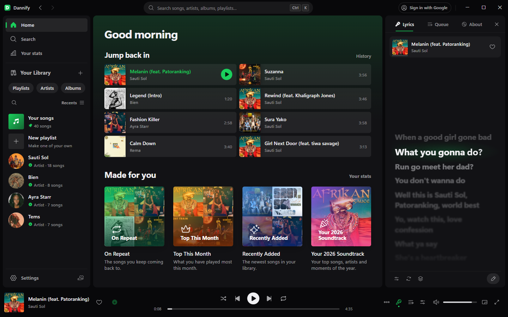

| | |
| --- | --- |
| 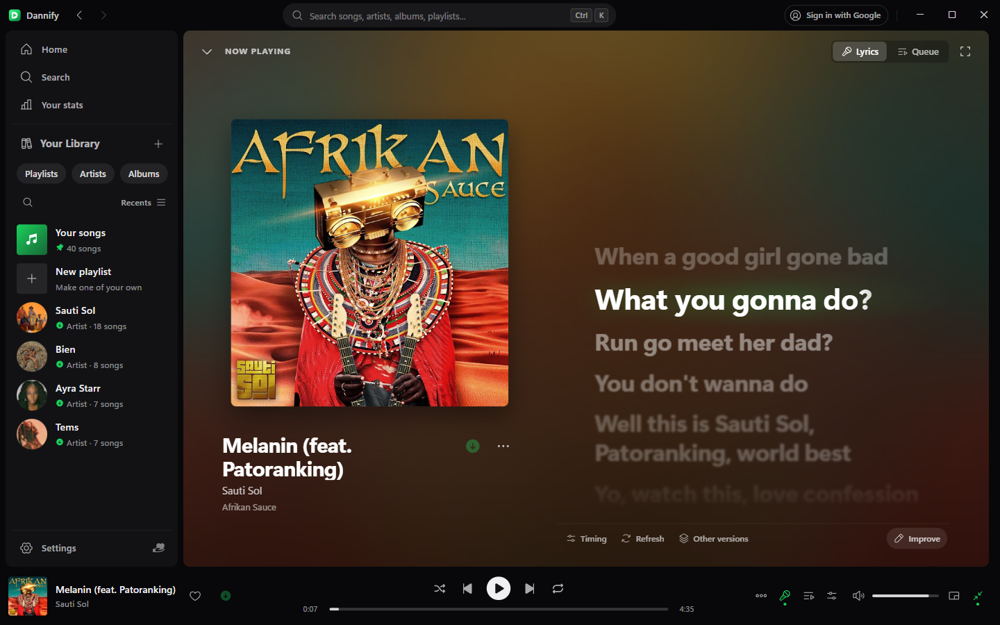 | 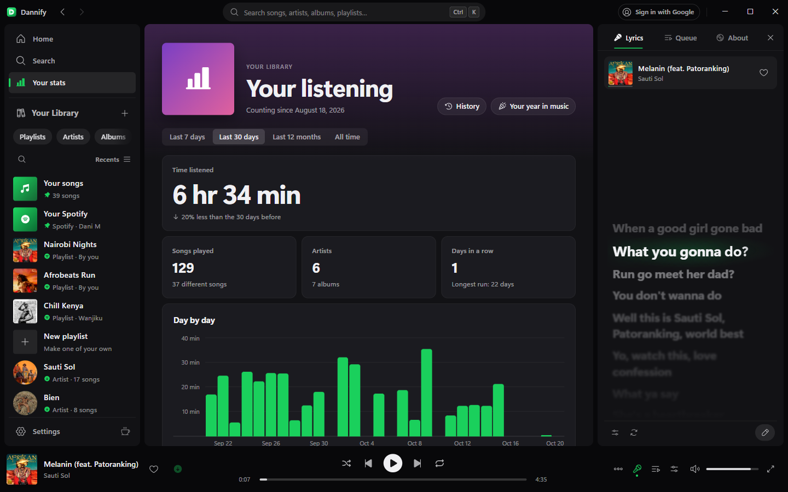 |
| 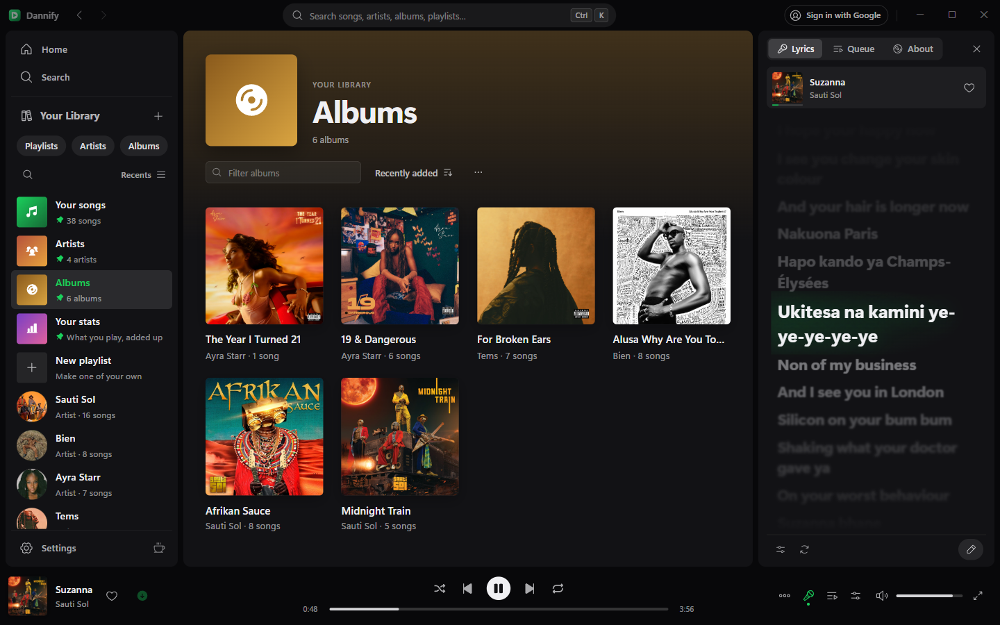 | 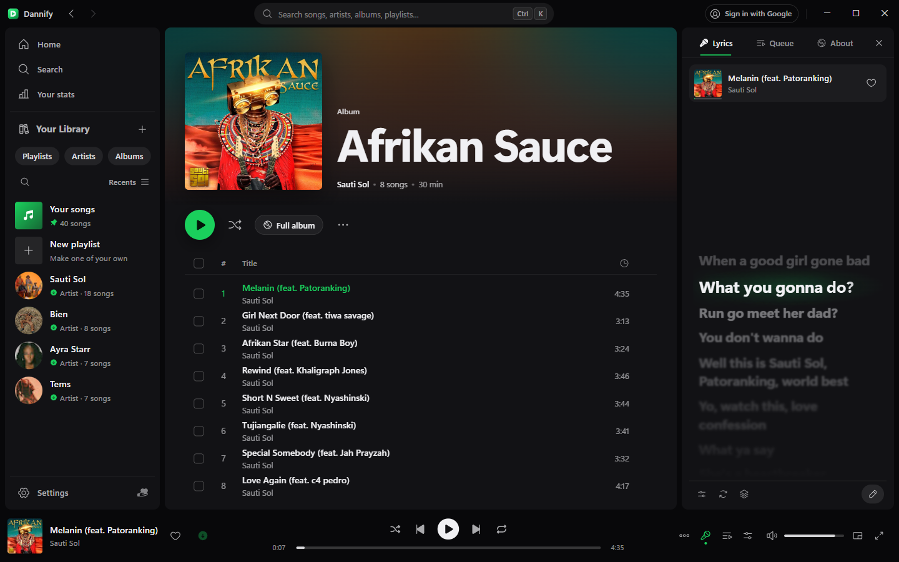 |
| 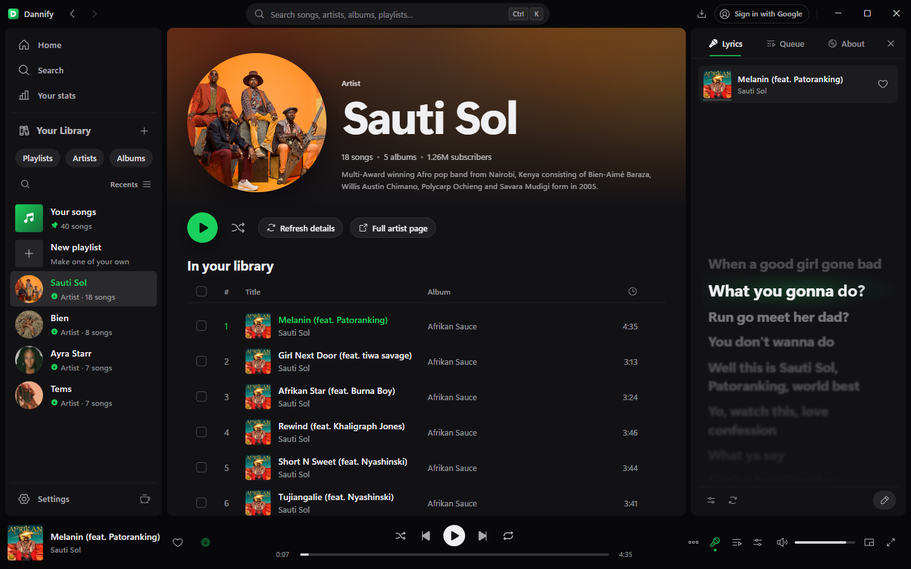 | 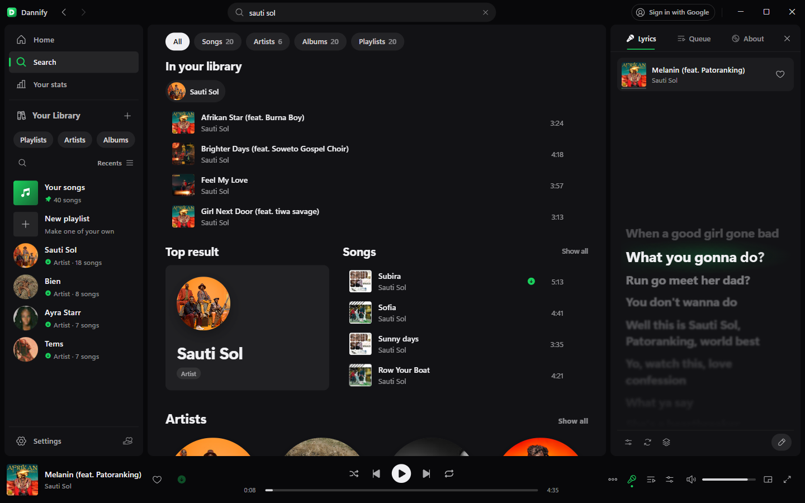 |
| 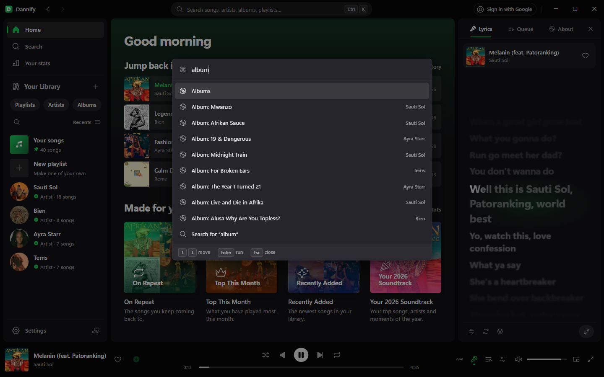 | 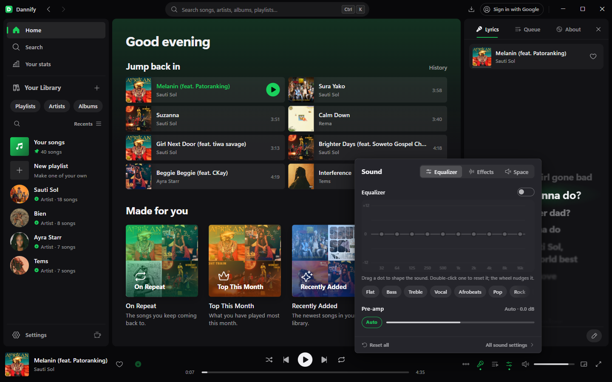 |
| 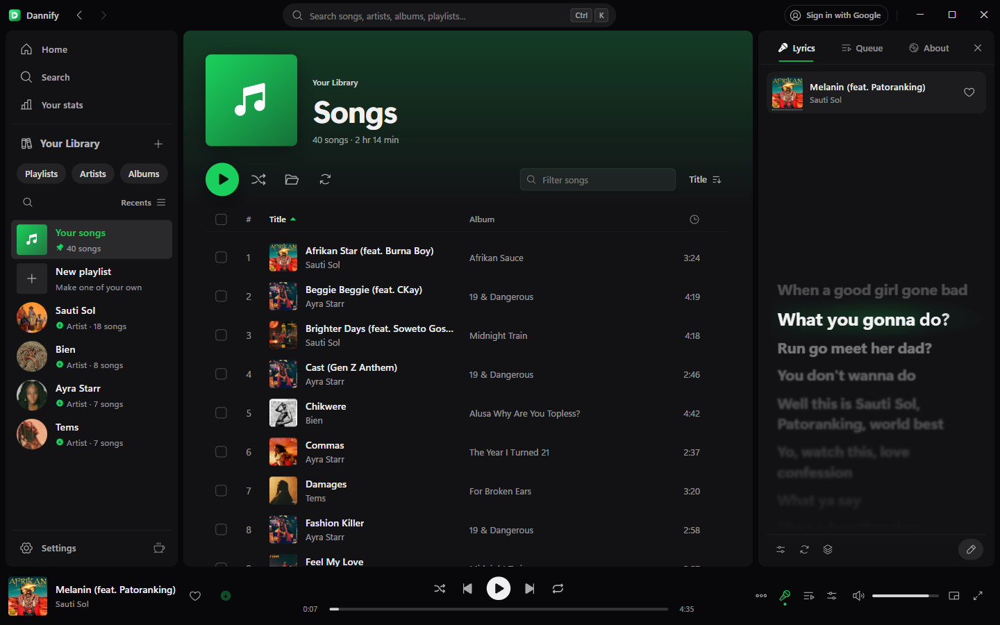 | 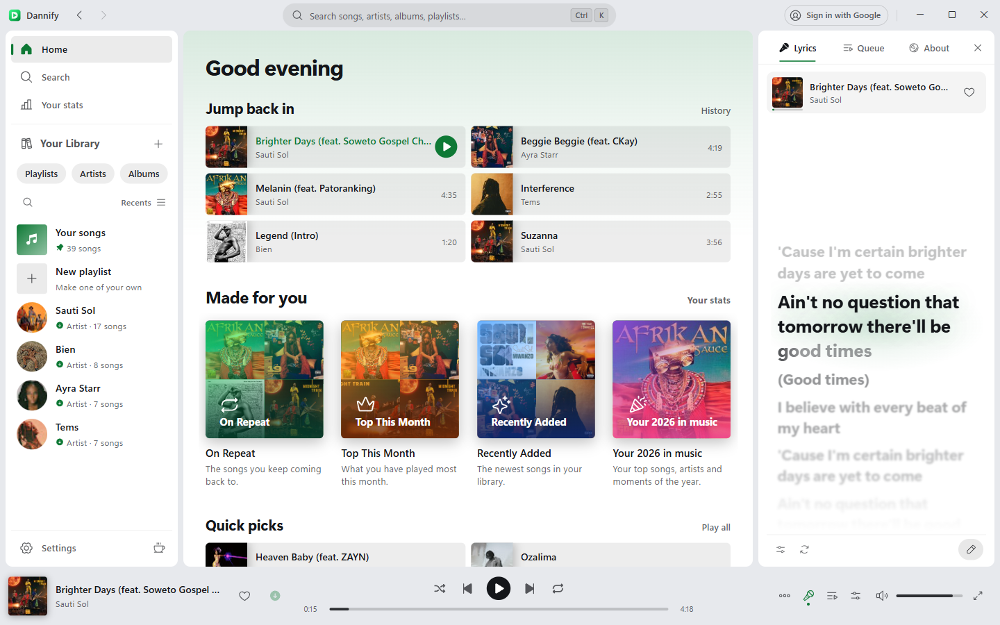 |

## What it does

Search the YouTube Music catalogue and play anything in about a third of a
second. Suggestions and results come in as you type.

Save whatever you want to keep. Saved songs live in your library, tagged
properly, with their artwork and lyrics, and play without a connection. They
are kept in Dannify's own sealed format, so they play in Dannify and not
elsewhere.

Your library is organised by song, artist, album and playlist. Each album
lists its songs in album order with their real track numbers, and one click
opens the whole album to save the rest of it.

It keeps a listening history, if you want it to. History shows what you
played day by day, and Your stats shows time listened, streaks, the hours you
listen at and your top songs, artists and albums. It stays on your computer;
connect ListenBrainz in Settings and your listens go to your profile there
too.

Lyrics scroll in a side panel and follow the song. If a track has none, there
is an editor for writing them and tapping the timing in, and what you write
goes out to everyone else playing that song.

Ctrl+Shift+P opens a command palette: any page, playback control, setting,
playlist, artist or album, by typing a few letters.

Sign in with Google and you get your own home feed, liked songs and playlists.

It picks up where you left off. Close it and the queue and the track you were
on come back next launch, paused at the second you stopped.

Closing the window keeps the music going. It drops to the tray instead of
quitting.

When something goes wrong it says so, with the fix beside it: a song that
will not play can be repaired (downloaded again in the same place), a music
folder that has gone can be chosen again, and saved songs from another PC or
account can be started afresh without deleting anything.

What changed in each version is in [CHANGELOG.md](CHANGELOG.md).

## Install

Everything is on the [downloads
page](https://github.com/Riskraptor/Dannify/releases):

- **Windows 10 and 11:** `Dannify-Setup-<version>.exe`.
- **Ubuntu, Debian, Mint and the like:** `linux-dannify_<version>_amd64.deb`,
  installed with `sudo apt install ./linux-dannify_<version>_amd64.deb`
  (see [packaging/linux](packaging/linux/README-UBUNTU.md)).
- **macOS:** `macos-Dannify-<version>-arm64.dmg` for Apple silicon, `-x64` for
  Intel Macs. The app is not notarized by Apple, so the first time, right-click
  it and choose Open (see [packaging/macos](packaging/macos/README.md)).

Every copy updates itself from signed releases.

## Building it

You need Python 3.14, Node 26 or newer, and the .NET SDK (8 or newer) for
the installer.

```powershell
cd Backend
python -m venv venv
.\venv\Scripts\pip install -r requirements.txt
cd ..\frontend
npm install
cd ..
pwsh packaging\build.ps1
```

That runs the backend and interface tests, then leaves you
`Backend\dist\Dannify\`, the installer `packaging\out\Dannify-Setup-<version>.exe`,
and the update package (`package-<version>.json` and `.zip`) beside it, all
signed (see [Signed releases](#signed-releases)). Building the installer needs
the release key; `-SkipInstaller` builds the app folder without it, and
`-Unsigned` builds everything and leaves the signing to `publish.ps1`, which
is how the release workflow builds on GitHub's Windows machine.

Two binaries are not in the repo because they are redistributables, not
source: the media encoder at `packaging\media\dnfmedia.exe` and the JS engine
at `packaging\jsruntime\dnfjs.exe`. The release workflow makes both: the
first is cross-compiled by `packaging/mediatool/build.sh`, the second is
QuickJS-ng's own Windows build, checked against its published checksum.
Notes in `packaging\config\README.md`.

## Working on it

```powershell
cd Backend
.\venv\Scripts\python.exe desktop.py
```

Environment variables worth knowing:

| Variable | What it does |
| --- | --- |
| `DANNIFY_INSTANCE` | Suffixes the single-instance lock so a second copy can run |
| `DANNIFY_DATA_DIR` | Settings, caches and the WebView profile |
| `DANNIFY_DEVTOOLS_PORT` | Remote debugging port. Source builds only |
| `DANNIFY_LOG_LEVEL` | `debug` when something is wrong |
| `DANNIFY_UPDATE_REPO` | Check a different `owner/name` for updates |
| `DANNIFY_UPDATE_API` | A stand-in release server, for testing updates. `127.0.0.1` only |
| `DANNIFY_KEY` | The key for `main.py` run on the network (`--host 0.0.0.0`). One is made up and printed if unset |

A second copy needs its own `DANNIFY_DATA_DIR`. WebView2 will not open the
same profile folder twice with different options, and you get a dead window
instead of a useful error.

## A note on how it plays

Streams resolve by talking to YouTube's app clients directly rather than going
through a general-purpose extractor. Those clients hand back a plain URL, so
there is no player script to download and no JavaScript challenge to solve.
Roughly 350 ms instead of fifteen seconds. yt-dlp is still there as a fallback
for the tracks those clients refuse.

The client identity strings are what make this work, and Google rotates them
every few months. They live in `Backend/dannify/clients.json` so a rotation is
a config fix, not a rebuild.

## Installing and updating

`installer/` is one small .NET Framework program that is the installer, the
launcher and the uninstaller. The setup is that program with the app packed
on the end. An install looks like this:

```
%LOCALAPPDATA%\Programs\Dannify\
  Dannify.exe     the launcher; shortcuts and the Apps entry point here
  app\            the app itself
```

The running app gets an update ready in `app-next\` in the background,
fetching only the files that changed out of `package-<version>.zip`. The
launcher swaps the folders the next time Dannify starts, or straight away on
Restart to update, and keeps the previous version. If the new one cannot
start, it goes back to the old one and skips that version.

`python packaging\lifecycle.py` runs install, launch, update, restart,
rollback and uninstall end to end in a sandbox that touches no real install,
registry entry or library. `upgrade`, `restart_previous`,
`setup_over_previous` and `rollback_previous` do the same starting from the
release before this one, the way people who already have Dannify will get the
new version, and `migrate` does it from a 3.x folder.

## Releases

The version lives in `Backend/dannify/__init__.py`; the build stamps it
everywhere else. A release is cut from any machine with PowerShell, the
project's Python environment (`Backend/venv`) and the release key; today that
is a Linux one. Bump the version, add its entry to [CHANGELOG.md](CHANGELOG.md),
merge, then tag and publish:

```bash
git tag v<version> && git push origin v<version>
pwsh packaging/publish.ps1 -Notes "what changed"
```

The notes are what the app shows as "What's new", so they are written for
the people using it: one line that says what the release is, then a
`## What's new` list and a `## Fixed` list, each item a short title, a colon
and one sentence ("Albums: every album you have saved songs from…"). Nothing
about files, commands, repositories or how the release was made: the release
page lists its files, and installing is described above. Copies before 4.9.2
show the first twelve lines of the notes as they are, so those must read well
on their own (see `frontend/src/model/releaseNotes.js`, which also leaves out
any `## Downloads` section).

Pushing the tag starts the release workflow, which builds every platform on
GitHub's machines: the Windows setup and update package, the Linux `.deb` and
the macOS apps. `publish.ps1` waits for it, downloads those builds, signs
them here with the offline release key (it never goes near GitHub), checks
every file against the key installed copies trust, and uploads everything as
one release. Each platform takes only its own files from it; installed copies
update from the latest release. `-DryRun` does all of it but the upload.

### Signed releases

From 4.7.0 every installed copy refuses an update that is not signed with
Dannify's release key. A SHA-256 only shows a download was not damaged; it
comes from the same release as the files, so it cannot show who made them.
The signature (Ed25519, `Backend/dannify/signing.py`) covers the package list,
which names every file's hash, the installer, the Linux package and the macOS
app. What is signed names the kind of file, its platform and processor, so a
signature can never be passed off for another platform's file.
`publish.ps1` signs every file (`build.ps1` signs the Windows ones itself
when it is run on a desk without `-Unsigned`); both check them against the
public key in `updates.py` before anything can be published.

```powershell
python packaging\release_key.py new      # once, ever: prints the PUBLIC_KEY line
python packaging\release_key.py public   # what updates.py must carry
```

The private key lives in `.dannify/release-signing.key` in the home folder
(`~` on Linux, `%USERPROFILE%` on Windows), or in `DANNIFY_RELEASE_KEY`, on the
release machine only: never in the repository and never in a CI secret.
**Back it up offline.** If you lose it, installed copies can only be moved to
a new key by installing by hand. If it leaks, anyone can sign an update.

That has happened once: the key 4.7.0 and 4.8.0 were signed with was lost
with the machine it was on. Copies of those two versions cannot take a later
release by themselves; the release after 4.8.0 has to be installed over them
by hand.

Windows code signing is separate and optional: set `DANNIFY_SIGN_THUMBPRINT`
to a code-signing certificate in `CurrentUser\My` and `build.ps1` signs the
setup, so SmartScreen stops warning. The installer reads its payload past an
Authenticode signature, and `pwsh packaging\test_installer.ps1` checks that,
signed and unsigned, on every CI run.

## Licence

MIT: see [LICENSE](LICENSE). Components made by others keep their own
licences, listed in [THIRD-PARTY-NOTICES.md](THIRD-PARTY-NOTICES.md).

---

Daniel Mwendwa
